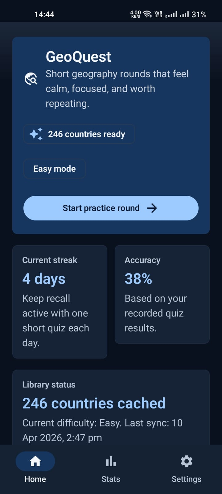
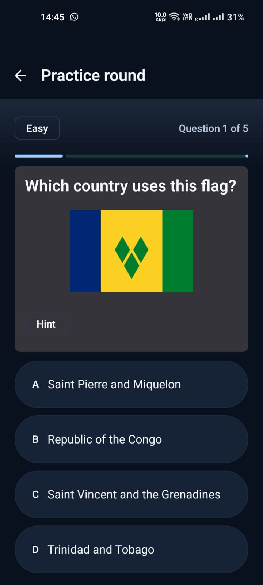
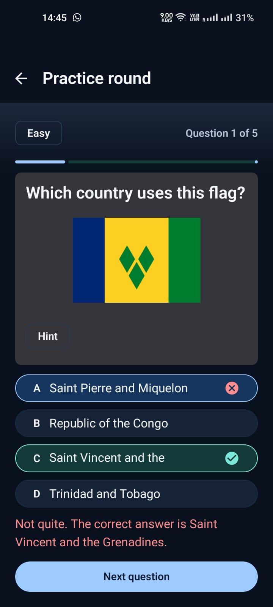
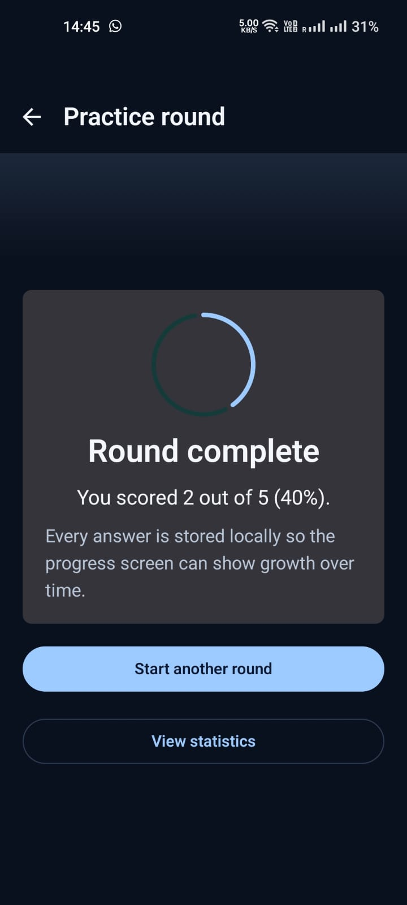
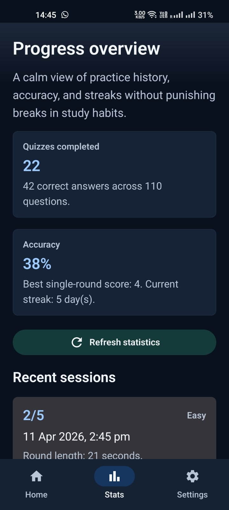
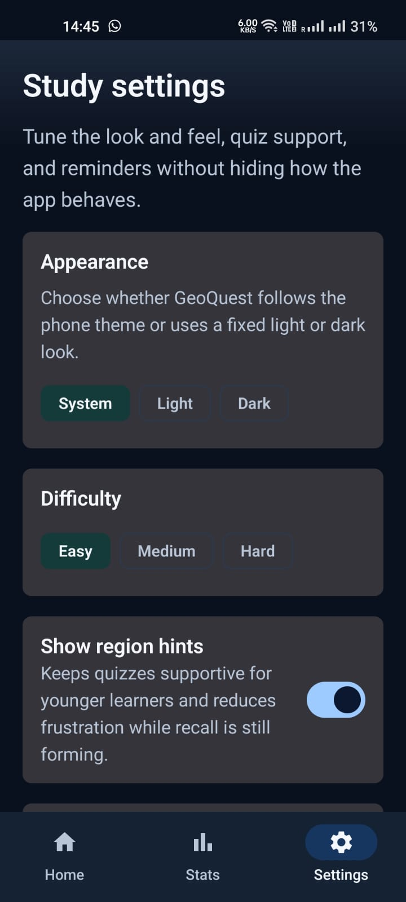
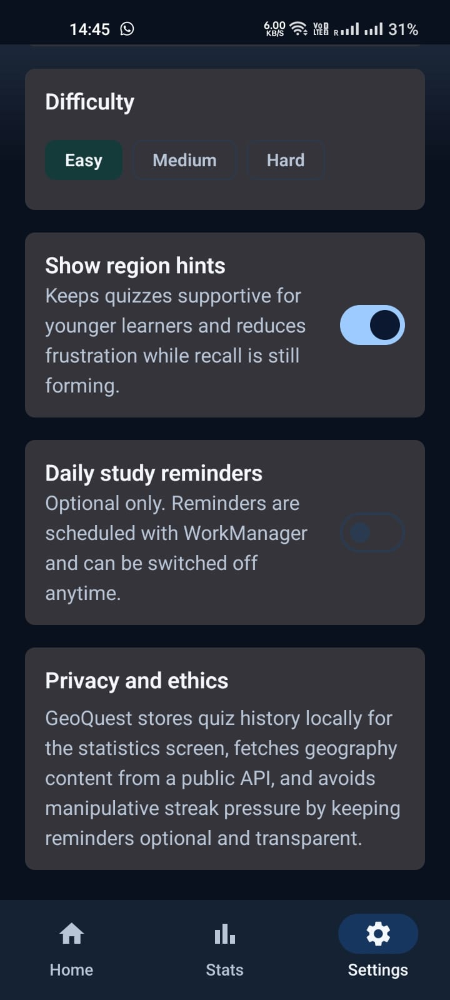
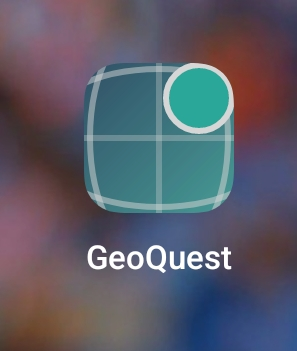
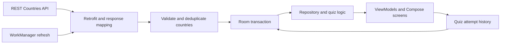

# GeoQuest

GeoQuest is an Android educational app built in Kotlin with Jetpack Compose for Assignment 3. The app helps secondary-school learners improve geography knowledge through short quiz rounds focused on country flags, capitals, revision habits, and progress tracking.

This academic project demonstrates API integration, asynchronous data processing, local persistence, explicit application state and permission-aware background work. The source and screenshots below provide an engineering walkthrough; the repository does not claim a commercial deployment or measured learning outcomes.

## Overview

The project was designed around the assessment requirements and the lecture topics covered in class:

- Android Studio + Kotlin
- Jetpack Compose + Material Design 3
- multi-screen navigation
- internet connectivity
- local persistence
- modern Android architecture
- testing
- ethical and accessible mobile design

## Core Features

- Home screen with learning summary, sync status, and quick actions
- Practice round screen with flag and capital questions
- Settings screen with difficulty, hints, reminders, and appearance mode
- Statistics screen with accuracy, streaks, and recent sessions
- Custom adaptive app icon and polished app-wide theme
- Optional hint reveal during quiz rounds
- Optional daily reminder notifications

## Screenshots

<table>
  <tr>
    <td align="center">
       
      <strong>Home</strong>
    </td>
    <td align="center">
       
      <strong>Quiz Question</strong>
    </td>
    <td align="center">
       
      <strong>Answer Feedback</strong>
    </td>
  </tr>
  <tr>
    <td align="center">
       
      <strong>Round Complete</strong>
    </td>
    <td align="center">
       
      <strong>Statistics</strong>
    </td>
    <td align="center">
       
      <strong>Settings</strong>
    </td>
  </tr>
  <tr>
    <td align="center">
       
      <strong>Reminders and Ethics</strong>
    </td>
    <td align="center">
       
      <strong>App Icon</strong>
    </td>
    <td></td>
  </tr>
</table>

## Technical Stack

- Kotlin
- Jetpack Compose
- Material 3
- Navigation Compose
- Room
- DataStore Preferences
- Retrofit + OkHttp
- Koin dependency injection
- WorkManager

## Architecture

The app follows an MVVM-style structure:

- `ui/` for Compose screens, navigation, and theming
- `data/` for Room, Retrofit, DataStore, and repository code
- `domain/` for quiz logic and statistics calculation
- `worker/` for background refresh and reminder scheduling

Main architectural decisions:

- `ViewModel` manages screen state
- `GeoQuestRepository` coordinates API, Room, and domain logic
- `UserPreferencesRepository` stores learner preferences in DataStore
- Room stores country cache and quiz attempt history

## API and Data Flow

`RestCountriesApi` requests the fields required by the application: country name, capital, region, subregion, population, flag and country code. Response mapping rejects entries without a name or code; the repository excludes entries without a capital and deduplicates by country code. Database replacement runs inside a Room transaction.

The repository uses Kotlin coroutines with `Dispatchers.IO` for API and database work. Quiz questions and statistics are calculated in domain classes, while ViewModels coordinate screen state. Preferences are stored separately in DataStore.

### Failure handling and trade-offs

- If an API request fails, the repository retains available cached country data. If the database is empty, it inserts a small built-in country set so the quiz has usable data.
- A successful API response with no usable countries also selects the built-in set. A future improvement would distinguish that condition from a successful remote refresh and preserve a larger existing cache.
- `CountryRefreshWorker` returns retry when the repository returns an unrecovered failure. A recovered cache/fallback result counts as success, so worker success alone does not prove that fresh API data was downloaded.
- Country-data fallback does not guarantee that remote flag images are available offline.
- Quiz attempts stay in the local database. Notification permissions and opt-in preferences control reminders.

These choices favour a usable educational app during connectivity problems. More detailed freshness indicators, repository-level failure tests and instrumentation would strengthen the design.

## Assessment Requirement Mapping

- Four core screens: implemented
- Navigation between screens: implemented
- Internet/API usage: implemented via REST Countries API
- Local database: implemented with Room
- User settings persistence: implemented with DataStore
- Background work: implemented with WorkManager
- Runtime permission handling: implemented for notifications
- Unit tests: implemented for quiz engine and statistics logic
- UI testing: Compose test source included

## Ethical and UX Decisions

GeoQuest was designed as a realistic but responsible study app:

- quiz history is stored locally rather than in the cloud
- reminders are opt-in, not forced
- notifications require permission before being enabled
- hints support learning without dark-pattern pressure
- progress language is supportive rather than guilt-driven
- the app avoids manipulative streak mechanics

## Running the App

1. Open the project in Android Studio.
2. Allow Gradle sync to finish.
3. Run the `app` configuration on an emulator or Android device.
4. If reminders are enabled on Android 13 or later, grant notification permission when prompted.

## Testing

Previously documented validation tasks:

- `assembleDebug`
- `testDebugUnitTest`
- `compileDebugAndroidTestKotlin`

`testDebugUnitTest` executes local unit tests. `compileDebugAndroidTestKotlin` compiles the instrumented test source; it does not execute UI tests on a device. Device-based execution requires a connected emulator or device, for example with `connectedDebugAndroidTest`.

The existing unit tests cover quiz logic and statistics. They do not establish API availability, repository recovery correctness, reminder delivery on every Android device or a production reliability rate. This documentation update was checked against source; the Android build and tests were not rerun for this update.

## Scope and Next Improvements

GeoQuest is an academic Android project. It uses conventional application logic rather than LLMs. Its relevance to workflow engineering is in integrating an external API, validating data, persisting state and managing background work with user permissions.

Useful next steps include automated tests for malformed API responses, cached-data recovery and empty responses; explicit remote-versus-fallback sync status; CI build validation; and instrumented testing of permissions and reminders.

## Submission Files

The repository includes the Android Studio project source code and this README.
